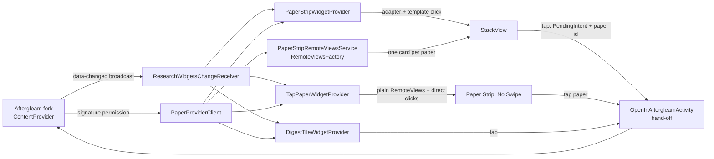

# Research Widgets

Nothing-style Android home-screen widgets for your research-paper feed. They are a companion to a customized fork of the [Aftergleam](https://github.com/jakobkreft/Aftergleam) reader: the widgets show today's papers, and a tap opens the paper in Aftergleam.


## Contents

- [Widgets](#widgets)
- [Look and theme](#look-and-theme)
- [Quick start](#quick-start)
- [Troubleshooting](#troubleshooting)
- [How it works](#how-it-works)
- [Requirements](#requirements)
- [Signing](#signing-is-required-for-ipc)
- [Build, CI and tests](#build-ci-and-tests)
- [Aftergleam fork compatibility](#aftergleam-fork-compatibility)
- [Status](#status)

## Widgets

| Widget | Size | What you get |
| --- | --- | --- |
| **Research Paper Strip** | about 5×1 | One title fills the widget. Swipe up or down to move through papers; tap the current title to open it. |
| **Paper Strip (No Swipe)** | about 5×1 | A separate, plain widget. Tap the paper to open it; tap the right edge, the dots or the counter for the next paper. No gestures. |
| **Aftergleam tile** | about 2×2 | A static launcher tile that opens Aftergleam. |
| **Digest tile** | about 2×2 | Inverted tile with one big number. **Latest** counts today's digest (saved count underneath); **Downloaded** counts PDFs kept on the device (today's count underneath). Long-press to reconfigure. In **Downloaded** mode, tapping it opens Aftergleam's Library on the **Offline** chip. |

Both strips can show the **Recommended** digest or your **Saved** papers, chosen per widget, in a **Bottom** or **Side** look.

- **Bottom**: position dots under the title.
- **Side**: a slim vertical dot rail on the right edge, with a `03/12` counter under the title.

The current paper is the red dot. The first paper is the first dot (leftmost in the Bottom look, top of the rail in the Side look) and the last paper is the last dot, so with 8 papers `1/8` is the leftmost dot and `8/8` the rightmost. There are at most 7 dots (a short Side widget may fit fewer). With fewer papers than dots, each paper gets its own dot; with more, the dots become a proportional meter and the counter gives the exact position.

The app itself is a small control panel with connection status, add buttons, placed-widget counts, a refresh button and a version label.

### Which strip should I use?

The swipe strip is built on Android's `StackView`, and the No Swipe strip on ordinary `RemoteViews`. Launchers differ in how they deliver taps from collection widgets, so if taps on the swipe strip do nothing on your launcher, use **Paper Strip (No Swipe)**. Both are kept so you can compare them side by side.

## Look and theme

All widgets follow Nothing "Classic" and draw from one shared set of `nothing_*` colour tokens, with matching light and dark sets that follow the system theme: monospace caps with letter spacing for labels, light sans-serif titles, red `#D71921` as the only accent, and a 28dp card corner radius. No widget hard-codes a colour.

Two things differ on purpose:

- The **Digest tile** is an inverted card (black in light mode, near-white in dark mode) so the big number stands out.
- The **Aftergleam tile** shows the green Aftergleam logo, which is legible on both card colours.

## Quick start

1. Install the **Aftergleam fork** first ([Aftergleam-For-Widgets](https://github.com/Placeholder2312/Aftergleam-For-Widgets)), then open it once so it builds today's digest.
2. Install the newest **Research Widgets** APK from [GitHub Releases](https://github.com/Placeholder2312/Research-Widgets/releases). Both APKs must be signed with the same certificate (see [Signing](#signing-is-required-for-ipc)). The newest release can be older than the source: compare the version label in the app with the [Status](#status) section.
3. Open Research Widgets. The status dot turns red when it can read Aftergleam.
4. Tap an **Add** button, or add a widget from your launcher's widget picker.
5. Pick a feed and a look when the setup screen appears.

## Troubleshooting

| Symptom | What it means | What to do |
| --- | --- | --- |
| Widget says "Install the customized Aftergleam fork" | The provider isn't installed | Install the fork, not the official app |
| "Access denied. Check that both apps use the same signing certificate." | Signature mismatch | Install APKs built with the same `RESEARCH_WIDGETS_*` keystore |
| Digest tile says **UPDATE AFTERGLEAM FORK** | The installed fork predates the `v1/downloaded` feed | Install a fork build from `main` at or after the downloaded-feed change |
| "Today's digest is empty or has not been built yet" | Aftergleam hasn't built a digest | Open Aftergleam once |
| Tapping a widget does nothing | Either the launcher is not delivering the tap, or the hand-off to Aftergleam is blocked | See below |

**Telling a broken tap from a broken hand-off.** The app has a **Test: open newest paper** button that fires the same Aftergleam intent from the foreground.

- Test button works, **Aftergleam tile** works, a **strip** does not: the strip's tap path is the problem. Use **Paper Strip (No Swipe)**.
- Test button works, no widget works: the launcher-to-app hand-off is blocked. Capture logcat while tapping (`adb logcat -s ActivityTaskManager AppWidgetHostView`) and look for `Background activity launch blocked!`.
- Test button fails: the problem is in Aftergleam or signing, not the widgets.

## How it works



| Package | Role |
| --- | --- |
| `data/` | Provider contract, read-only client (never throws; returns a state and message), per-widget preferences |
| `widget/` | Widget providers, the card factory, hand-off activity, `PendingIntent` helper, boot and data-changed receivers |
| `ui/` | Control-panel activity and the per-widget setup screens |

Design notes:

- **No network, no polling.** The app declares no internet permission. Papers come from a read-only `ContentProvider` guarded by a signature permission. Aftergleam sends a protected change broadcast and the widgets re-query. One `FeedPass` is shared across all widget providers for that broadcast, so each feed is queried at most once; adapter reloads reuse the short-lived provider cache. Resize-only updates reuse recent reads.
- **Reliable taps.** Android can silently block one app launching another from a window that isn't visible yet, and Android 15+ changed how a `PendingIntent` creator lends launch rights. Taps therefore go to a tiny translucent hand-off activity that opens Aftergleam from `onResume`, once its window is up, and the `PendingIntent` opts in to the creator launch privilege.
- **Full-width cards in `StackView`.** `StackView` measures cards with `AT_MOST` and parks back cards in the other 10% of its size. On Android 12+ the provider enlarges the stack to `widget / 0.9`, anchors it bottom-start, clips the back cards and sizes every card explicitly.
- **Layout fitting.** Title size comes from width tiers; the number of title lines (2, 3 or 5, via separate layouts) comes from the widget height after reserving space for dots or the counter. Bottom and Side each have their own layouts.
- **Honest position indicator.** The dots never show a position the widget isn't at, and the screen-reader description says "Paper 3 of 12".
- **Dependency-free.** Plain Android SDK, no third-party runtime libraries.

## Requirements

- Android 8.0+ (minSdk 26, targetSdk 37). The full-width title fix applies on Android 12+.
- The customized Aftergleam fork. The official app does not expose this API.
- Both APKs signed with the same certificate.

## Signing is required for IPC

Both apps must use the same locally controlled certificate to reach the signature-protected provider and paper-opening endpoint. Set the same values for both projects, outside Git:

- `RESEARCH_WIDGETS_KEYSTORE`
- `RESEARCH_WIDGETS_KEYSTORE_PASSWORD`
- `RESEARCH_WIDGETS_KEY_ALIAS`
- `RESEARCH_WIDGETS_KEY_PASSWORD`

This key signs debug and release builds when configured. Never commit keystores or passwords. Default debug keys from two separate projects differ and fail the signature check.

## Build, CI and tests

```bash
./gradlew testDebugUnitTest assembleDebug
```

The APK is written to `app/build/outputs/apk/debug/`. Prebuilt, signed debug APKs are published to [GitHub Releases](https://github.com/Placeholder2312/Research-Widgets/releases) as `research-widgets-v<version>-build-<n>`.

**CI.** GitHub Actions is manual-only (`workflow_dispatch`). It validates the shared keystore from repository secrets, builds, runs the unit tests, verifies the APK signature and publishes the APK to Releases.

**Tests.** Robolectric unit tests cover provider row mapping, graceful handling of a missing provider, per-widget feed and style storage (including widget restore) and the Aftergleam v1 IPC contract. Plain JUnit tests cover `FeedPass` (each feed is queried once per refresh pass; resizing never forces a query) and `PaperDots` (which dot is red, including first-to-last order and the proportional meter).

## Aftergleam fork compatibility

Paired with [`Placeholder2312/Aftergleam-For-Widgets`](https://github.com/Placeholder2312/Aftergleam-For-Widgets), branch `main`. The IPC contract is v1, protected by the `si.jakobkreft.aftergleam.permission.READ_RESEARCH_WIDGETS` signature permission.

| Piece | Value |
| --- | --- |
| Authority | `si.jakobkreft.aftergleam.researchwidgets` |
| Feeds | `v1/recommended`, `v1/saved`, `v1/downloaded` |
| Columns | the seven declared in `AftergleamContract` |
| Paper-open endpoint | `si.jakobkreft.aftergleam.integration.PaperOpenActivity` |
| Change broadcast | `si.jakobkreft.aftergleam.action.RESEARCH_WIDGETS_DATA_CHANGED` |

The `v1/downloaded` feed, used by the Digest tile's **Downloaded** mode, is part of the fork's `main`. A fork build from before that change rejects the request, and the tile then shows "UPDATE AFTERGLEAM FORK" while everything else keeps working.

Both apps must be installed with the same signing certificate, and both repositories' workflows require the same `RESEARCH_WIDGETS_*` secrets.

## Status

**Source version:** 1.10.5 (versionCode 21). The matching APK is [research-widgets-v1.10.5-build-51](https://github.com/Placeholder2312/Research-Widgets/releases/tag/research-widgets-v1.10.5-build-51). GitHub lists CI builds as pre-releases, so scroll past any older "latest" entry on the [Releases](https://github.com/Placeholder2312/Research-Widgets/releases) page.

**Checked so far**

- CI run #51 passed for this version: the Gradle build and unit tests (Robolectric included), resource linking, shared-certificate APK signature verification, and publishing.
- All Kotlin sources also compile against the Android 36 SDK outside CI, and the `FeedPass` and `PaperDots` unit tests pass on the JVM.

**Not yet checked for this version**

- Lint. CI does not run it.
- Physical devices: taps, swipe, both looks, the dot order, and the Aftergleam tile in light and dark mode. Launcher hosts differ, so these need confirming on your own phone.

**Known limits**

- It needs the customized Aftergleam fork and the same signing certificate on both apps.
- Taps on the swipe strip depend on the launcher; **Paper Strip (No Swipe)** is the fallback.
- The full-width title fix applies on Android 12+ only.
- Widgets refresh when Aftergleam sends its change broadcast, on boot or app update, and from the control panel's refresh button. There is no periodic refresh.

See [docs/IMPLEMENTATION-PLAN.md](docs/IMPLEMENTATION-PLAN.md) for the phased plan and what is verified.
