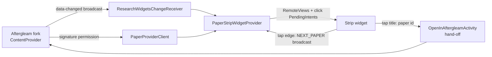

# Research Widgets

Nothing-style Android home-screen widgets that put today's research papers one tap away — a companion to a customized fork of the Aftergleam research-paper app.


## What it does

| Widget | What you get |
| --- | --- |
| **Research Paper Strip** (about 5×1) | One paper title fills the widget. Tap the title to open that paper in Aftergleam; tap the right edge, the dots or the counter to show the next paper (it wraps around). Choose the **Recommended** digest or **Saved** papers per widget, and a **Row** or **Rail** look. |
| **Aftergleam tile** (about 2×2) | A static launcher tile that opens Aftergleam. |
| **Digest tile** (about 2×2) | Inverted black/white tile with one big number. **Latest** counts today's digest (saved count underneath); **Downloaded** counts PDFs kept on the device (today's count underneath). Pick the mode per tile; long-press to reconfigure. Updates when Aftergleam's data changes; tap opens Aftergleam. |

The app itself is a small control panel: connection status (red dot when connected), add buttons and placed-widget counts for each widget, a refresh button, and a version label.

**Strip styles**

- **Row** — position dots under the title.
- **Rail** — a vertical dot rail on the right edge, plus an `03/12` counter.

In both, the current paper is the red dot. With up to 7 papers each paper gets its own dot; beyond that the dots become a proportional meter (first dot = first paper, last dot = last paper) and the counter gives the exact position.

Design follows the Nothing "Classic" look: light/dark from the system, monospace caps for labels, light sans-serif titles, red `#D71921` as the single accent, 28dp card radius.

## Engineering highlights

- **No collection widgets.** The strip used to be a `StackView` swipe widget. Collections can only handle taps through a template `PendingIntent` plus per-item fill-in intents, and on the target device that path never delivered a tap, while plain click `PendingIntent`s (the tiles, the in-app test button) did. The strip is now an ordinary `RemoteViews` widget that shows one paper and keeps its position per widget instance. The trade-off is that swiping is gone: plain widgets cannot receive gestures, so "next" is a tap.
- **Layout fitting.** Title size comes from width tiers; the number of title lines (2/3/5 via separate layouts) is computed from the widget height after reserving space for dots or the counter. Row and Rail each have their own set.
- **Honest position indicator.** The dot meter never shows a position the widget isn't at: 1:1 up to 7 papers, proportional above, with a numeric counter and a screen-reader description ("Paper 3 of 12").
- **Reliable taps.** Android can silently block one app launching another from a window that isn't visible yet, and Android 15+ also changed how a `PendingIntent` creator lends launch rights. Widget taps go to a tiny translucent hand-off activity (allowed as a launcher/widget launch) that opens Aftergleam from `onResume`, once its window is up, and the `PendingIntent` opts in to the creator launch privilege. A "Test: open newest paper" button in the app fires the same Aftergleam intent from the foreground.
- **Signature-protected IPC.** Papers are read from a read-only `ContentProvider` guarded by a signature permission; no network permission and no polling. Aftergleam pushes a protected change broadcast and the widgets re-query.
- **Small and dependency-free.** Plain Android SDK, no third-party runtime libraries. Provider reads are cached for a few seconds so repeated updates share one query.

## Architecture



| Package | Role |
| --- | --- |
| `data/` | Provider contract, read-only client (never throws; returns a state and message), per-widget preferences |
| `widget/` | Widget providers, hand-off activity, PendingIntent helper, boot/update and data-changed receivers |
| `ui/` | Control-panel activity and the per-widget setup screen |

## Requirements

- Android 8.0+ (minSdk 26, targetSdk 37).
- The customized Aftergleam fork installed first. The official app does not expose this API. The Digest tile's *Downloaded* mode also needs a fork build that serves `v1/downloaded`; older builds show "UPDATE AFTERGLEAM FORK".
- Both APKs signed with the same certificate (see below).

## Signing is required for IPC

Both apps must use the same locally controlled certificate to access the signature-protected provider and paper-opening endpoint. Configure the same values for both projects, outside Git, as environment variables:

- `RESEARCH_WIDGETS_KEYSTORE`
- `RESEARCH_WIDGETS_KEYSTORE_PASSWORD`
- `RESEARCH_WIDGETS_KEY_ALIAS`
- `RESEARCH_WIDGETS_KEY_PASSWORD`

The companion uses this key for debug and release builds when configured. Never commit keystores or passwords. Default debug keys from two separate projects do not match and fail the signature check.

## Build and install

```bash
./gradlew testDebugUnitTest assembleDebug
```

The APK is written to `app/build/outputs/apk/debug/`. Prebuilt, signed debug APKs are on [GitHub Releases](https://github.com/Placeholder2312/Research-Widgets/releases) (`research-widgets-v<version>-build-<n>`). Install the Aftergleam fork first, then install the newest release over any previous one.

## CI

GitHub Actions is manual-only (`workflow_dispatch`). It validates the shared keystore from repository secrets, builds, runs the unit tests, verifies the APK signature and publishes the APK to Releases.

## Tests

Robolectric unit tests cover provider row mapping, graceful handling of a missing provider, and per-widget feed/style storage including widget restore.

## Status

Builds and unit tests pass in CI. Taps and both styles still need confirmation on physical devices, since launcher hosts differ; see [docs/IMPLEMENTATION-PLAN.md](docs/IMPLEMENTATION-PLAN.md) for the phased plan and what is verified.
