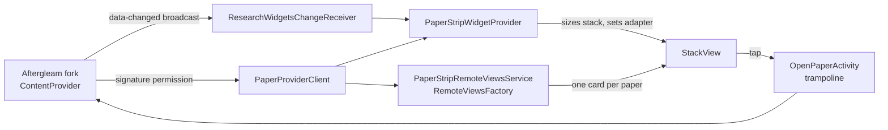

# Research Widgets

Nothing-style Android home-screen widgets that put today's research papers one swipe away — a companion to a customized fork of the Aftergleam research-paper app.


## What it does

| Widget | What you get |
| --- | --- |
| **Research Paper Strip** (about 5×1) | One paper title fills the widget. Swipe up/down to move through the feed, tap to open the paper in Aftergleam. Choose the **Recommended** digest or **Saved** papers per widget, and a **Row** or **Rail** look. |
| **Aftergleam tile** (about 2×2) | A static launcher tile that opens Aftergleam. |

The app itself is a small control panel: connection status, add/refresh buttons for each widget, and a version label.

**Strip styles**

- **Row** — position dots under the title.
- **Rail** — a vertical dot rail on the right edge, aligned with the swipe direction, plus an `03/12` counter.

In both, the current paper is the red dot. With up to 7 papers each paper gets its own dot; beyond that the dots become a proportional meter (first dot = first paper, last dot = last paper) and the counter gives the exact position.

Design follows the Nothing "Classic" look: light/dark from the system, monospace caps for labels, light sans-serif titles, red `#D71921` as the single accent, 28dp card radius.

## Engineering highlights

- **Full-width paging inside RemoteViews limits.** Widgets can't run arbitrary views, so swiping uses the platform `StackView`. It measures cards with `AT_MOST` (cards shrink to their text) and renders back cards offset to one side. The fix: on Android 12+ the provider enlarges the stack to `widget / 0.9` (StackView gives children 90% of its size), anchors it bottom-start so the back cards fall outside and are clipped, and sizes every card explicitly to the widget minus StackView's built-in frame padding.
- **Layout fitting.** Title size comes from width tiers; the number of title lines (2/3/5 via separate layouts) is computed from the widget height after reserving space for dots or the counter. Row and Rail each have their own set.
- **Honest position indicator.** The dot meter never shows a position the widget isn't at: 1:1 up to 7 papers, proportional above, with a numeric counter and a screen-reader description ("Paper 3 of 12").
- **Reliable taps.** Launchers sending a mutable `PendingIntent` straight to another app fail silently. Taps go to an in-app trampoline activity that forwards to Aftergleam and shows a message on failure (for example a signing-key mismatch).
- **Signature-protected IPC.** Papers are read from a read-only `ContentProvider` guarded by a signature permission; no network permission and no polling. Aftergleam pushes a protected change broadcast and the widgets re-query.
- **Small and dependency-free.** Plain Android SDK, no third-party runtime libraries, roughly a thousand lines of Kotlin. Provider reads are cached for a few seconds so the widget and its list adapter share one query.

## Architecture



| Package | Role |
| --- | --- |
| `data/` | Provider contract, read-only client (never throws; returns a state and message), per-widget preferences |
| `widget/` | Widget providers, the card factory, tap trampoline, boot/update and data-changed receivers |
| `ui/` | Control-panel activity and the per-widget setup screen |

## Requirements

- Android 8.0+ (minSdk 26, targetSdk 37). The full-width title fix targets Android 12+.
- The customized Aftergleam fork installed first. The official app does not expose this API.
- Both APKs signed with the same certificate (see below).

## Signing is required for IPC

Both apps must use the same locally controlled certificate to access the signature-protected provider and paper-opening endpoint. Configure the same values for both projects, outside Git, as environment variables:

- `RESEARCH_WIDGETS_KEYSTORE`
- `RESEARCH_WIDGETS_KEYSTORE_PASSWORD`
- `RESEARCH_WIDGETS_KEY_ALIAS`
- `RESEARCH_WIDGETS_KEY_PASSWORD`

The companion uses this key for debug and release builds when configured. Never commit keystores or passwords. Default debug keys from two separate projects do not match and fail the signature check.

## Build and install

```bash
./gradlew testDebugUnitTest assembleDebug
```

The APK is written to `app/build/outputs/apk/debug/`. Prebuilt, signed debug APKs are on [GitHub Releases](https://github.com/Placeholder2312/Research-Widgets/releases) (`research-widgets-v<version>-build-<n>`). Install the Aftergleam fork first, then install the newest release over any previous one.

## CI

GitHub Actions is manual-only (`workflow_dispatch`). It validates the shared keystore from repository secrets, builds, runs the unit tests, verifies the APK signature and publishes the APK to Releases.

## Tests

Robolectric unit tests cover provider row mapping, graceful handling of a missing provider, and per-widget feed/style storage including widget restore.

## Status

Builds and unit tests pass in CI. Swipe, tap and both styles still need confirmation on physical devices, since launcher hosts differ; see [docs/IMPLEMENTATION-PLAN.md](docs/IMPLEMENTATION-PLAN.md) for the phased plan and what is verified.
