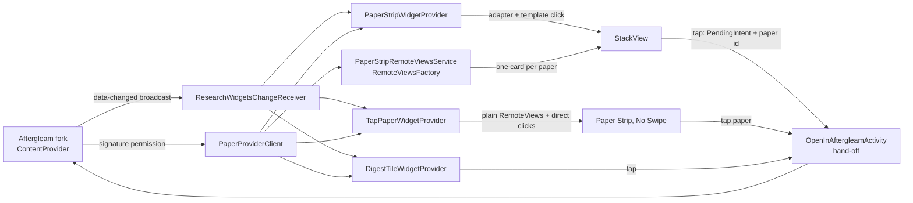

# Architecture

Research Widgets is a native Android companion for the customized Aftergleam reader. It reads paper metadata through Aftergleam's signature-protected, read-only `ContentProvider`; it does not make network requests itself.

## Data flow

## Package map

| Package | Role |
| --- | --- |
| `data/` | Provider contract, read-only client (never throws; returns a state and message), per-widget preferences |
| `widget/` | Widget providers, the card factory, hand-off activity, `PendingIntent` helper, boot and data-changed receivers |
| `ui/` | Control-panel activity and the per-widget setup screens |

## Implementation notes

- **No network, no polling.** Papers come from a read-only `ContentProvider` guarded by a signature permission. Aftergleam sends a protected change broadcast and the widgets re-query. One `FeedPass` is shared across all widget providers for that broadcast, so each feed is queried at most once; adapter reloads reuse the short-lived provider cache. Resize-only updates reuse recent reads.
- **Reliable taps.** Android can silently block one app launching another from a window that isn't visible yet, and Android 15+ changed how a `PendingIntent` creator lends launch rights. Taps therefore go to a tiny translucent hand-off activity that opens Aftergleam from `onResume`, once its window is up, and the `PendingIntent` opts in to the creator launch privilege.
- **Full-width cards in `StackView`.** `StackView` measures cards with `AT_MOST` and parks back cards in the other 10% of its size. On Android 12+ the provider enlarges the stack to `widget / 0.9`, anchors it bottom-start, clips the back cards and sizes every card explicitly.
- **Layout fitting.** Title size comes from width tiers; the number of title lines (2, 3 or 5, via separate layouts) comes from the widget height after reserving space for dots or the counter. Bottom and Side each have their own layouts.
- **Honest position indicator.** The dots never show a position the widget isn't at, and the screen-reader description says "Paper 3 of 12".
- **Dependency-free.** Plain Android SDK, no third-party runtime libraries.

## Refresh behavior

When Aftergleam sends its protected data-changed broadcast, `ResearchWidgetsChangeReceiver` creates one `FeedPass` and shares it with the Paper Strip, Paper Strip (No Swipe), and Digest tile providers. Each feed is force-queried at most once during that pass; later reads of that feed reuse the pass's recent result. The swipe strip's `RemoteViewsFactory` also reuses the provider client's short-lived cache. Resize-only callbacks use non-fresh passes so repeated launcher resize events do not needlessly query the provider.
